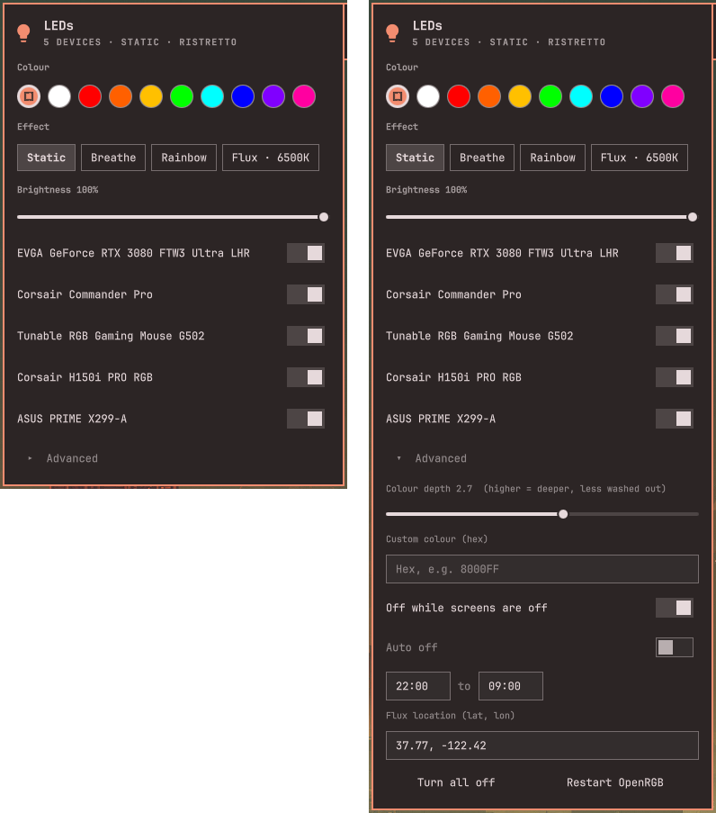

# omarchy_led_controller

An [Omarchy](https://omarchy.org) bar widget that controls all the RGB lighting in your PC
from one place: case strips, cooler, GPU, mouse and anything else
[OpenRGB](https://openrgb.org) supports. Your lights can follow your desktop theme or the
sun, go dark when your screens sleep or at bedtime, and stay in sync no matter whether you
change them from the panel, the terminal or a schedule.

## Features

- Colour presets, including one that follows your Omarchy theme
- Static, Breathe, Rainbow and **Flux**: white by day, warm at sunset, red at night
- Brightness, plus an on/off switch for each device
- Right-click the bulb to turn everything off or back on
- Lights go dark while your screens are asleep
- Optional night schedule, e.g. off from 22:00 to 09:00
- A `led` command that does everything the panel does



## Requirements

- Omarchy 4 (Hyprland 0.56 or newer)
- OpenRGB, with the `i2c-dev` module for GPU, RAM and motherboard lighting:

  ```
  sudo pacman -S openrgb
  echo i2c-dev | sudo tee /etc/modules-load.d/i2c-dev.conf && sudo modprobe i2c-dev
  ```

## Install

```
omarchy plugin add https://github.com/goldbattle/omarchy_led_controller.git
~/.config/omarchy/plugins/com.pgeneva.omarchy_led_controller/install.sh
```

`omarchy plugin add` only copies the files. `install.sh` does the rest: it puts `led` on your
PATH, starts the OpenRGB server as a user service, and adds the timers that handle the night
schedule, Flux and sleeping screens. Rerun it after updating.

## Using it

Left-click the bulb for the panel, right-click to toggle everything. The same from a terminal:

```
led state                                  # what's on, as JSON
led set 8000FF -m breathing -b 60          # colour, effect (static breathing rainbow flux), brightness
led set theme                              # follow the Omarchy theme colour
led on | led off
led device "Corsair Commander Pro" off     # one device
led schedule '{"auto_off": true, "off": "22:00", "on": "09:00"}'
led restart                                # restart OpenRGB, re-detect devices
```

Settings live in `~/.config/led.json`.

A few things worth knowing:

- **Flux** goes by the sun, not the clock, so set your location under Advanced (it starts in
  San Francisco).
- **Auto off** only acts when the night window starts and ends. If you turn the lights on in
  the middle of the night, they stay on until morning.
- **Colour depth** (Advanced) makes LEDs look closer to the colour you see on screen. Without
  it, soft theme colours come out almost white. Lower it if colours look too dark.

## Troubleshooting

- **The panel says "led failed"**: check the server with `systemctl --user status openrgb`.
- **OpenRGB takes a minute or more to find devices**: if you have a Logitech wireless
  receiver, OpenRGB's `Logitech HID++ 2.0` detector can stall on it
  ([OpenRGB#5918](https://gitlab.com/CalcProgrammer1/OpenRGB/-/issues/5918)). Turn that
  detector off in OpenRGB's settings, or in `~/.config/OpenRGB/OpenRGB.json`, then run
  `led restart`.
- **A device is missing**: run `led restart`. If it still doesn't show up, check whether
  `openrgb --list-devices` sees it; if not, it's an OpenRGB issue.
- **Changing the code, or checking it on your hardware**: see
  [docs/development.md](docs/development.md) for how to install a clone and the agent skills
  that run the tests and a live hardware check.

## Tested hardware

Anything OpenRGB detects should work. These devices have been tried. "Works" means colour,
every effect, brightness and the on/off switch all behave.

| Device | Type | Connection | Status | Notes |
|---|---|---|---|---|
| EVGA RTX 3080 FTW3 Ultra LHR (3842:4897) | GPU | NVIDIA i2c | Works | |
| Corsair Commander PRO (1b1c:0c10) | LED strips | USB | Works | [Set the strip length](docs/corsair-commander-pro.md) |
| Corsair H150i Platinum (1b1c:0c12) | Cooler | USB | Works | OpenRGB names it "H150i PRO RGB" |
| Logitech G502 Proteus Spectrum (046d:c332) | Mouse | USB | Works | |
| ASUS PRIME X299-A | Motherboard | SMBus (Super I/O) | Works with an extra | [Needs the asus-aura extra](docs/asus-aura.md) |

The [extras](extras/) folder holds optional add-ons for hardware OpenRGB can't reach yet.
**You don't need it** unless a row above links you there.

**Add your hardware.** Run the agent skill `/add-tested-hardware` in this repo. It finds your
devices, walks you through a quick test of each one (you watch the lights and say what
happened), puts your settings back afterwards, and adds the results to this table. No serial
numbers or other details about your machine are recorded. Then open a pull request. You can
also test by hand with the `led` commands above and add a row yourself.
